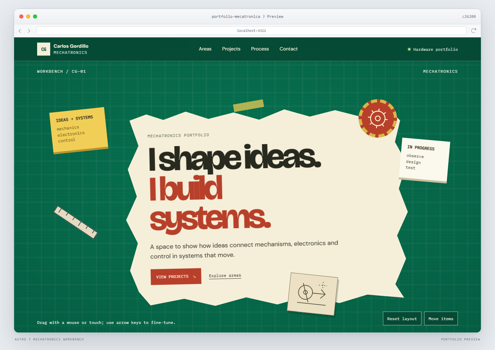

# Mechatronics Portfolio

An independent Astro portfolio for the hardware and mechatronics side of Carlos Gordillo's work.



## Overview

The page is an interactive engineering workbench: a green cutting-mat surface runs throughout the site, while loose notes and notebook-style project cards can be rearranged.

## Features

- Drag notes, tools and project cards with a mouse or touch.
- Move focused items with the arrow keys.
- Save the workbench layout in the browser or restore the default arrangement.
- Responsive layout with no drag interaction required to reach the content.
- Astro static output with lightweight, client-side interactions.

## Stack

- Astro 7.4.8
- TypeScript
- CSS and inline SVG

## Run locally

Requires Node.js 22.22.0 or later.

```bash
npm install
npm run dev
```

Quality checks:

```bash
npm run check
npm run build
```

## Project structure

```text
src/
├── components/      # Workbench, practice areas, project cards and contact
├── data/            # Editable profile, practice areas and project templates
├── layouts/         # Shared page shell and metadata
├── pages/           # Astro routes
└── styles/          # Global workbench grid and design tokens
```

## Content status

The project cards and practice-area prompts are editable placeholders, not claims about completed work. Replace them with real project descriptions, tools and results in `src/data/portfolio.ts`.

The contact email and GitHub profile are reused from the existing software portfolio and can also be changed in that file. This repository and site are separate from the software portfolio.
